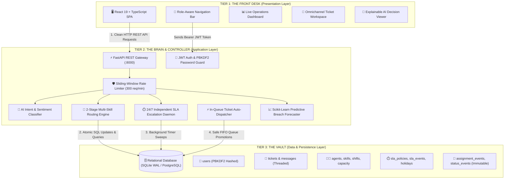
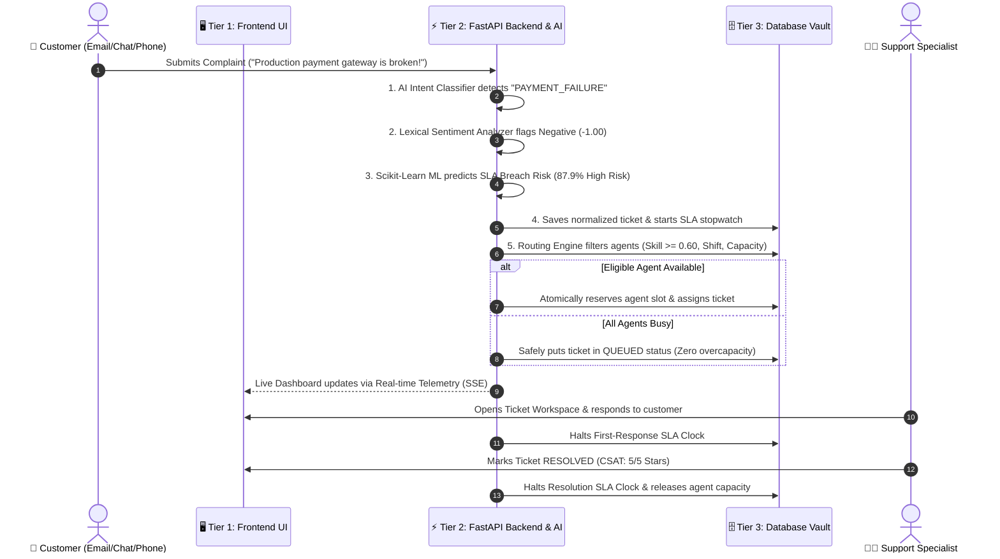

# ⚡ OmniRoute AI — The Intelligent Ticket Router & SLA Guardian

[](file:///docs/testing-report.md)
[](file:///docs/architecture.md)
[](https://react.dev)
[](https://fastapi.tiangolo.com)
[](file:///docs/database-schema.md)
[](https://scikit-learn.org)

> 💡 **What is OmniRoute AI in plain English?**  
> Imagine an **Airport Air Traffic Controller**, but for customer support. When thousands of angry or urgent customer complaints fly in through **Email, Live Chat, and Phone**, OmniRoute AI instantly acts as the air traffic controller:
> 1. It reads the customer's emotions and problem with **AI**.
> 2. It checks which human agent has the exact **matching skills, language, and free capacity**.
> 3. It assigns the ticket in milliseconds and starts a **background SLA stopwatch**.
> 4. If an agent gets overwhelmed, an **in-queue dispatcher** steps in automatically.

---

## 🏛️ The Three-Tier Architecture — How the System Works Separately

OmniRoute AI strictly separates its responsibilities into **Three Independent Tiers**.  
None of the tiers cheat or cross boundaries:



### Is each tier working separately?
| Tier | Technology | What it Does | What it NEVER Does |
|---|---|---|---|
| **Tier 1 (Presentation)** | React 19, TypeScript, Vite, Tailwind CSS | Displays screens, buttons, charts, and forms to the user. | **Never touches the database directly.** It only talks to Tier 2 via HTTP REST APIs. |
| **Tier 2 (Application)** | Python 3.12, FastAPI, Scikit-learn, APScheduler | Runs business logic, scoring formulas, AI sentiment analysis, and the 60s background SLA stopwatch. | **Never renders HTML directly.** It is a pure, stateless API backend. |
| **Tier 3 (Persistence)** | SQLite WAL local / PostgreSQL production | Safely stores all tickets, messages, audit logs, and agent capacities with foreign keys and ACID locks. | **Never executes business rules.** It simply ensures data integrity, safety, and persistence. |

---

## 🚀 The Complete Customer Journey (Visual Flowchart)

Here is how a complaint travels from a frustrated customer to a 5-star resolution:



---

## 🎯 Core Features Explained for Everyone

### 1. 🤖 AI Sentiment & Intent Detective
When a message arrives, OmniRoute AI reads the customer's text:
- **Intent**: Automatically tags if it's a *Payment Failure*, *Hardware Defect*, *Billing Query*, or *General Question*.
- **Emotion**: Analyzes if the customer is furious, frustrated, or happy on a score from `-1.0` (angry) to `+1.0` (happy).
- **Supervisor Warning**: If a customer gets angrier mid-conversation, it instantly raises a **Supervisor Alert** in the Anomaly Center!

### 2. 🎯 Smart Matchmaker (Two-Stage Routing)
Unlike simple round-robin systems that blindly dump tickets on the next person, OmniRoute AI uses a 2-stage matchmaker:
- **Stage 1 (Must-Have Checklist)**:
  - Is the agent clocked in on shift?
  - Do they speak the customer's language?
  - Do they have the required technical skill with proficiency score $\ge 60\%$?
  - Do they have free capacity slots left?
- **Stage 2 (Best-Fit Scoring)**:
  $$\text{Score} = 35\% \times \text{Skill} + 25\% \times \text{Language} + 25\% \times \text{Free Capacity} + 15\% \times \text{Experience}$$
  *(Plus bonuses for agents who know multiple technical domains).*

### 3. ⏱️ The Independent SLA Stopwatch
- **Critical Emergencies (P1)**: The timer ticks **24 hours a day, 7 days a week, 365 days a year**.
- **Standard Requests (P2–P4)**: Respects business hours (Monday–Friday 09:00 to 18:00 IST), automatically pausing over weekends and enterprise holidays.
- **Dynamic Holiday Calendar**: Admins can add company holidays on the fly, and the stopwatch automatically recalculates due dates!

### 4. 📈 Real Machine Learning Risk Forecaster
Using a trained **Scikit-Learn Logistic Regression Model**, the system calculates the probability that a ticket will breach its deadline before it actually happens, highlighting the top factors (e.g. *Weekend arrival*, *Email latency*, *High priority workload*).

### 5. 🛡️ Enterprise Security & Rate Limiting
- **JWT Authentication & RBAC**: Role-based access control with secure PBKDF2 password hashing.
- **Sliding-Window Rate Limiter**: Automatically blocks spam or denial-of-service attacks by capping requests at 300 per minute per IP.

---

## 🧪 Verified Test Suite — 66 / 66 Tests Passing (100% Green)

The entire backend and business logic is continuously validated by 66 automated tests:

```text
============================= test session starts =============================
backend/tests/test_advanced_features.py ......                           [  9%]
backend/tests/test_auth_rbac.py .....                                    [ 16%]
backend/tests/test_mandatory_20_scenarios.py ....................        [ 46%]
backend/tests/test_omnichannel_routing.py ................               [ 71%]
backend/tests/test_phase6_negative_scenarios.py ..............           [ 92%]
backend/tests/test_predictive_sla.py ...                                 [ 96%]
backend/tests/test_queue_dispatcher.py ..                                [100%]

======================= 66 passed, 18 warnings in 13.70s =======================
```

---

## 💻 Quickstart Installation & Run Guide

### 1. Clone the Repository
```bash
git clone https://github.com/luffy-2601/YottaflexAI_Hackathon.git
cd YottaflexAI_Hackathon
```

### 2. Install Dependencies
```bash
# Python backend dependencies
pip install -r requirements.txt

# React frontend dependencies
cd frontend && npm install && npm run build && cd ..
```

### 3. Start the Application
```bash
python -m uvicorn backend.app.main:app --host 0.0.0.0 --port 8000
```
- **Web App**: Open [http://localhost:8000/](http://localhost:8000/) in your browser.
- **Interactive API Documentation**: Open [http://localhost:8000/docs](http://localhost:8000/docs).

---

## 🔑 Fast Login for Hackathon Judges & Evaluators

In the top navigation bar, click **"Sign In (JWT)"** and use the **1-Click Presets**:

| Account | Email | Password | Role |
|---|---|---|---|
| **Admin Evaluator** | `admin.evaluator@hackathon.org` | `SecureEnterprisePassword2026!` *(or `Password123!`)* | Full Admin & Analytics |
| **Support Agent** | `agent.smith@matrix.com` | `CorrectHorseBatteryStaple123` *(or `Password123!`)* | Ticket Resolution & Messaging |

---

## 🎬 Live Hackathon Demo (Simulated Tenants)

Run the automated live demonstration script showing a complete customer ticket journey across **Jio Telecom**, **Amazon India**, and **Flipkart Retail**:

```powershell
$env:PYTHONPATH="."; python scripts/hackathon_demo.py
```

---

## 📁 Repository Structure

```
├── frontend/                   # Tier 1: React 19 UI & Dashboard
│   ├── src/components/         # Navbar, Modals, Shared Widgets
│   ├── src/pages/              # Dashboard, Tickets, SLA Monitor, Simulator
│   └── src/services/api.ts     # Typed API Client with Bearer Token Auto-Injection
├── backend/                    # Tier 2: FastAPI Application Layer
│   ├── app/api/v1/             # REST Endpoints (Auth, Tickets, Routing, SLA, Telemetry)
│   ├── app/core/               # Security, Database Config, Rate Limiter
│   ├── app/models/             # SQLAlchemy Relational Models (3NF)
│   ├── app/schemas/            # Pydantic v2 Contracts
│   ├── app/services/           # Routing Engine, SLA Engine, ML Forecaster, Classifier
│   └── tests/                  # Pytest Automated Test Suite (66 Tests)
├── docs/                       # Architecture, Database Schema, API Reference, Testing Reports
├── scripts/                    # Live Demo Scripts, Reproducibility Checker, Synthetic Seeders
├── docker-compose.yml          # Container Deployment Manifest
├── .env.example                # Example Environment Variables
└── README.md                   # Complete Visual Guide & Documentation
```
