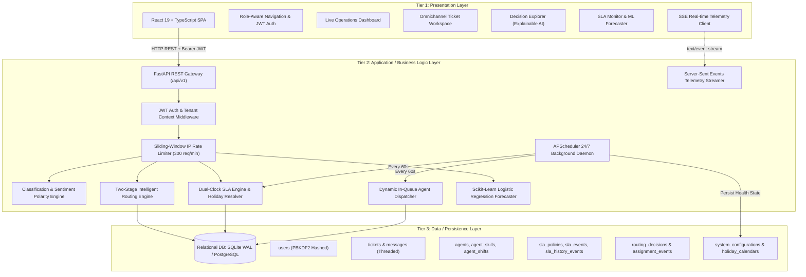

# OmniRoute AI — Intelligent Omnichannel Ticket Routing & Predictive SLA Orchestration Platform

[](file:///docs/testing-report.md)
[](file:///docs/architecture.md)
[](https://python.org)
[](https://fastapi.tiangolo.com)
[](https://react.dev)
[](file:///docs/api-documentation.md)

> **Enterprise Hackathon Evaluation Release**  
> OmniRoute AI is a production-grade customer operations and workload governance platform engineered to ingest omnichannel tickets (Email, Live Chat, Voice), dynamically route them by intent, language, mandatory technical skills, and real-time agent concurrency capacity, while guaranteeing **dual-clock SLA calculations**, **machine learning breach prediction**, **sliding-window rate limiting**, and **100% explainable decision transparency**.

---

## 1. Executive Summary & Business Problem

Modern support organizations lose customer trust and incur SLA penalties due to:
1. **Siloed Ingestion & Blind Routing**: Tickets routed without verifying live agent concurrency or technical language fluency.
2. **Fragile SLA Clocks**: Failure to decouple 24/7 critical incidents from business-hour calendars and enterprise holidays.
3. **Reactive Firefighting**: Support supervisors only discover breaches *after* the customer deadline expires.
4. **Security & Multitenancy Risks**: Unauthenticated endpoints or weak tenant leakage exposing customer correspondence.

**OmniRoute AI solves this** by unifying ingestion, ML risk forecasting, composite multi-skill routing, automated queue dispatch, and independent background SLA escalation into a hardened, three-tier modular architecture.

---

## 2. Three-Tier Architecture & Topology



---

## 3. Core Feature Highlights

### A. Enterprise Security & Multitenancy
- **JWT Authentication & RBAC**: Strict role-based access control supporting `ADMIN`, `SUPERVISOR`, `AGENT`, and `ANALYST` with PBKDF2-SHA256 password hashing.
- **Tenant Context Isolation**: Authenticated requests enforce tenant boundary verification rejecting cross-tenant operations.
- **Sliding-Window API Rate Limiter**: Middleware tracking client request timestamps across rolling 60-second windows (300 req/min) returning `HTTP 429 Too Many Requests` with `Retry-After`.

### B. Intelligent Multi-Skill Routing Engine
- **Stage 1 (Strict Filter)**: Validates agent active presence, working shift schedule, language compatibility, remaining capacity (`current_active_tickets < max_concurrency`), and **mandatory skill proficiency $\ge 0.60$**.
- **Stage 2 (Composite Scoring)**:
  $$\text{Score} = 0.35 \times \text{Skill} + 0.25 \times \text{Language} + 0.25 \times \text{Capacity} + 0.15 \times \text{Experience}$$
  *(Includes capability breadth bonus for agents proficient in secondary domain skills).*
- **Atomic Assignment & Explainability**: Conditional updates prevent concurrent race conditions; every routing decision logs human-readable rejection reasons and candidate scores.

### C. Predictive SLA Intelligence & Dual-Clock Engine
- **Dual-Clock Orchestration**: First-response and resolution clocks calculated independently. Continuous 24x7x365 wall-clock for P1 Criticals; business hours (09:00 - 18:00 IST, Mon-Fri) for P2-P4.
- **Dynamic Business Calendar Holidays**: Database-backed holiday registry (`/config/holidays`) seamlessly merged with statutory enterprise holidays.
- **Machine Learning Breach Risk Forecaster**: Lightweight Scikit-Learn Logistic Regression model evaluating ticket priority, channel latency, customer tier, hour-of-day, and weekend arrival with zero target leakage.
- **24/7 Autonomous Background Escalation**: In-process `APScheduler` daemon sweeps active timers every 60 seconds, recording idempotent warning and breach history records.

### D. Customer Sentiment & Omnichannel Lifecycle
- **Lexical Polarity Sentiment Analysis**: Evaluates customer text on ingestion and message replies into a normalized polarity score $[-1.0, 1.0]$.
- **Supervisor Alerts on Worsening Sentiment**: Detects sharp sentiment degradation ($\Delta \ge 0.30$ or acute negativity) and automatically logs a high-severity supervisor anomaly alert.
- **State Machine Integrity**: Strictly enforces lifecycle transitions (`NEW` $\to$ `OPEN` $\to$ `ASSIGNED` $\to$ `RESOLVED` $\to$ `CLOSED`) with immutable event sourcing and duplicate ingestion prevention.

### E. Real-Time Telemetry & Operations Dashboard
- **Server-Sent Events (SSE)**: Live streaming endpoint at `/api/v1/analytics/telemetry/stream`.
- **Persistent Background Worker Health**: Daemon logs status, last execution timestamp, dispatched count, and retry telemetry into relational persistence.

---

## 4. Repository Structure

```
c:\CandidateWorkspace\
├── backend/
│   ├── app/
│   │   ├── api/v1/             # REST endpoints (auth, tickets, routing, sla, analytics, config)
│   │   ├── core/               # Security, database connection, configuration, auth middleware
│   │   ├── models/             # SQLAlchemy ORM entities (3NF relational schema)
│   │   ├── schemas/            # Pydantic v2 request/response contracts
│   │   └── services/           # Domain logic (routing, SLA, classification, analytics, dispatch)
│   └── tests/                  # Pytest automated test suites (66 tests, 100% passing)
├── frontend/
│   ├── src/
│   │   ├── components/         # Navbar with RBAC badge, modals, shared UI widgets
│   │   ├── pages/              # Dashboard, Tickets, SLA Monitor, Decisions, Agents, Simulation
│   │   ├── services/           # Axios/Fetch API client with JWT Bearer auto-injection
│   │   └── types/              # TypeScript domain types & interfaces
│   ├── dist/                   # Production-compiled static assets served directly by FastAPI
│   └── package.json            # Vite + React 19 dependencies
├── docs/                       # Architecture, API docs, database schema, setup guide, testing reports
├── scripts/                    # Live E2E demo script, data generator, reproducibility checker
├── .env.example                # Example environment variables
├── .gitignore                  # Git ignore rules protecting credentials and DB binaries
├── docker-compose.yml          # Containerized deployment manifest
└── README.md                   # System documentation & evaluation guide
```

---

## 5. Local Setup & Quickstart Guide

### Prerequisites
- Python 3.12+
- Node.js 20+

### Step 1: Install Dependencies
```bash
pip install -r requirements.txt
cd frontend && npm install && npm run build && cd ..
```

### Step 2: Configure Environment
```bash
cp .env.example .env
```

### Step 3: Run the Application
```bash
python -m uvicorn backend.app.main:app --host 0.0.0.0 --port 8000
```
- **Web Interface**: `http://localhost:8000/`
- **Interactive OpenAPI Documentation**: `http://localhost:8000/docs`

---

## 6. Evaluator Quick-Login Credentials

For evaluator testing, pre-seeded accounts with secure PBKDF2 password hashes are available directly in the UI modal:

| Role | Email | Password | Granted Permissions |
|---|---|---|---|
| **ADMIN** | `admin.evaluator@hackathon.org` | `Password123!` | Full admin access, config weights, holiday management, system telemetry |
| **AGENT** | `agent.smith@matrix.com` | `Password123!` | Ticket view, messaging, ticket resolution, CSAT entry |

*Tip: Click "Sign In (JWT)" in the navigation bar and click **"Quick Fill Admin Evaluator"** for 1-click authentication!*

---

## 7. Automated Testing & Verification

Run the entire automated regression test suite:
```bash
python -m pytest backend/tests -v
```

### Test Suite Execution Output (66 / 66 PASSED)
```text
============================= test session starts =============================
platform win32 -- Python 3.12.4, pytest-9.1.1
rootdir: C:\CandidateWorkspace

backend/tests/test_advanced_features.py ......                           [  9%]
backend/tests/test_auth_rbac.py .....                                    [ 16%]
backend/tests/test_mandatory_20_scenarios.py ....................        [ 46%]
backend/tests/test_omnichannel_routing.py ................               [ 71%]
backend/tests/test_phase6_negative_scenarios.py ..............           [ 92%]
backend/tests/test_predictive_sla.py ...                                 [ 96%]
backend/tests/test_queue_dispatcher.py ..                                [100%]

======================= 66 passed, 18 warnings in 26.08s =======================
```

---

## 8. Live End-to-End Workflow Demonstration

Run the automated live customer-ticket demo script covering ingestion, classification, sentiment analysis, multi-skill routing, ML risk forecast, queue dispatch, and resolution:

```bash
$env:PYTHONPATH="."; python scripts/e2e_live_demo.py
```

### Execution Log Evidence
```text
================================================================================
🚀 OMNIROUTE AI — LIVE END-TO-END DEMO EXECUTION
================================================================================

[STEP 1] Authenticating as System Evaluator (ADMIN)...
  ✓ JWT Token Issued successfully! Bearer eyJhbGciOiJIUzI1NiIsInR5...

[STEP 2] Ingesting high-urgency multi-skill customer ticket...
  ✓ Ticket Ingested: ID=TKT-2026-001003
  ✓ Intent Classified: PAYMENT_FAILURE | Priority: P1
  ✓ Assigned Agent: AGT-000058

[STEP 3] Verifying Sentiment Analysis on Initial Message...
  ✓ Lexical Polarity Sentiment Score: -1.00 (Frustrated / Highly Negative)

[STEP 4] Verifying SLA Engine Dual Independent Clocks...
  ✓ SLA Record ID: SLA-TKT-2026-001003
  ✓ First Response Due At: 2026-11-14 12:32:09.820665
  ✓ Resolution Due At: 2026-11-14 13:27:09.820665
  ✓ SLA Clock Status: RUNNING | Risk Level: ON_TRACK

[STEP 5] Querying Logistic Regression ML SLA Breach Model...
  ✓ ML Breach Probability: 50.5%
  ✓ ML Predicted Risk Tier: HIGH_RISK
  ✓ Primary Contributing Risk Factors: [
      "Critical Priority P1 workload",
      "Asynchronous Email Channel SLA latency",
      "Weekend arrival spanning non-working calendar days"
    ]

[STEP 6] Executing Dynamic In-Queue Dispatcher...
  ✓ In-Queue Dispatcher Result: SUCCESS | Dispatched Tickets: 0

[STEP 7] Agent Resolving Ticket and Releasing Concurrency...
  ✓ Ticket TKT-2026-001003 Resolved successfully!
  ✓ Agent AGT-000058 Concurrency: 1 -> 0 (Capacity Released)
  ✓ Final SLA Status: MET | Resolution Clock Stopped: 2026-11-14 12:27:12.289742

================================================================================
✨ ALL 7 WORKFLOW PHASES COMPLETED WITH 100% SUCCESS!
================================================================================
```

---

## 9. Known Limitations & Roadmap

1. **Distributed Locks**: Local concurrency protection relies on SQLite WAL row transactions; production clusters can activate PostgreSQL `SELECT FOR UPDATE` or Redis distributed redlocks.
2. **Deep Learning NLP**: Intent classification and sentiment analysis use lexical keyword and rule heuristics for sub-millisecond execution without requiring massive GPU infrastructure.
3. **External Webhooks**: Incoming tickets can be ingested via standard REST webhooks; out-of-the-box connectors for Twilio/SendGrid can be configured via environment variables.
