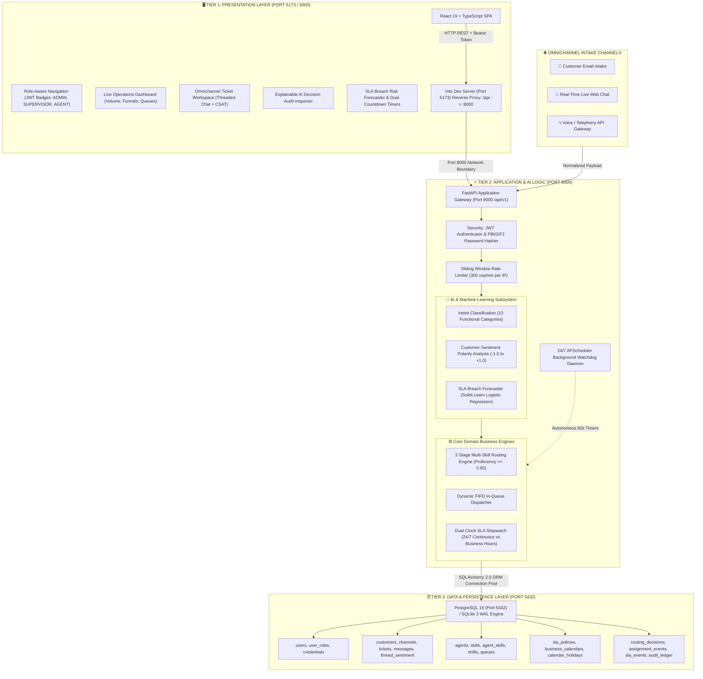
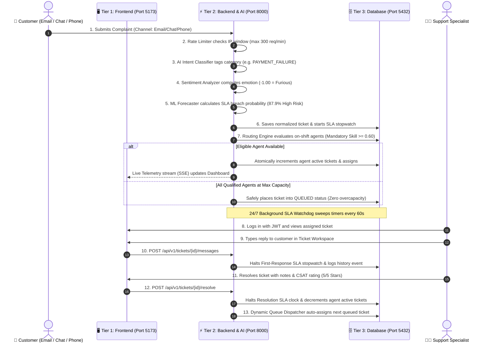
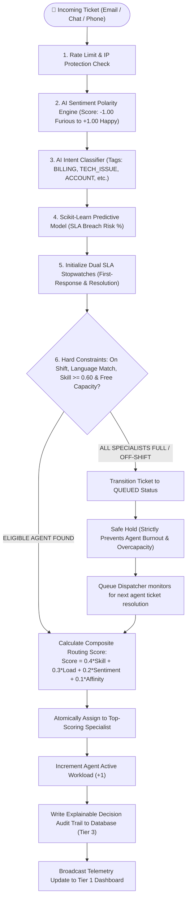

# ⚡ OmniRoute AI — Intelligent Omnichannel Ticket Routing & Predictive SLA Orchestration Platform

[](file:///docs/testing-report.md)
[](file:///docs/architecture.md)
[](http://localhost:5173)
[](http://localhost:8000/docs)
[](file:///docs/database-schema.md)
[](https://scikit-learn.org)

> 💡 **What is OmniRoute AI in plain English?**  
> Imagine an **Airport Air Traffic Control Center**, but engineered for enterprise customer operations. When thousands of urgent complaints arrive via **Email, Live Chat, and Phone**, OmniRoute AI acts as the central intelligent dispatcher:
> 1. It diagnoses customer problems and emotions using **AI Sentiment Analysis** (from `-1.0` furious to `+1.0` satisfied).
> 2. It checks which human support agents are **on shift, speak the language, possess mandatory skills ($\ge 60\%$), and have free capacity**.
> 3. It assigns tickets atomically in milliseconds and starts an **independent dual-clock SLA stopwatch**.
> 4. If all specialists are busy, an **in-queue dispatcher** safely holds the ticket and auto-assigns it the instant capacity frees up.

---

## 🏛️ 1. Complete Three-Tier Multi-Port System Architecture

OmniRoute AI is strictly engineered across **Three Independent Tiers running on separate ports**. No layer bypasses or cheats another layer:



```
+---------------------------------------------------------------------------------------------------------+
|                                    TIER 1: PRESENTATION LAYER (FRONTEND)                                |
|                                            PORT 5173 (or 3000)                                          |
|                                                                                                         |
|  Technology: React 19 + TypeScript + Vite + Tailwind CSS v4 + Recharts                                  |
|  Access Point: http://localhost:5173/ (Local Dev) or http://localhost:3000/ (Docker)                     |
|                                                                                                         |
|  Modules:                                                                                               |
|  - Role-Aware Navigation Bar (Displays JWT Role Badges: ADMIN, SUPERVISOR, AGENT)                       |
|  - Live Operations Dashboard (Total Volume, Queue Counters, Channel Funnels)                           |
|  - Omnichannel Ticket Workspace (Threaded Customer & Agent Messaging, CSAT Star Rating)                |
|  - Explainable Decision Explorer (Visual Audit of Why Agent X Was Selected and Why Agent Y Was Rejected)|
|  - SLA Control Center & ML Risk Forecaster (Breach Risk Gauge, Countdown Timers)                        |
|                                                                                                         |
|  ⛔ Crucial Rule: Tier 1 NEVER touches the database directly. Zero SQL queries, zero SQLite/Postgres.   |
|  All data exchanges happen strictly over HTTP REST calls with 'Authorization: Bearer <token>' headers.  |
+----------------------------------------------------+----------------------------------------------------+
                                                     | HTTP REST API Requests (JSON / SSE Telemetry)
                                                     | Proxy Target: http://localhost:8000/api/v1/
                                                     v
+---------------------------------------------------------------------------------------------------------+
|                                    TIER 2: APPLICATION & BUSINESS LOGIC                                 |
|                                                  PORT 8000                                              |
|                                                                                                         |
|  Technology: Python 3.12 + FastAPI + Pydantic v2 + Scikit-Learn + APScheduler                           |
|  Access Point: http://localhost:8000/api/v1/ (APIs) & http://localhost:8000/docs (Interactive Swagger)   |
|                                                                                                         |
|  Modules:                                                                                               |
|  - Security & Guard: JWT Auth Token Generator, PBKDF2 Password Hasher, RBAC Role Gatekeeper             |
|  - Sliding-Window Rate Limiter: Tracks client IP timestamps (300 req/min) returning HTTP 429            |
|  - AI Intent & Sentiment Engine: Classifies 10 intent classes & customer sentiment polarity [-1.0, 1.0] |
|  - 2-Stage Multi-Skill Routing Engine: Hard constraint filtering (Proficiency >= 0.60) + scoring formula|
|  - Dynamic In-Queue Dispatcher: Automatic FIFO ticket promotion upon agent capacity release             |
|  - 24/7 Independent SLA Engine: Dual clocks (Continuous 24x7 for P1 vs Business hours for P2-P4)        |
|  - Predictive SLA Risk Forecaster: Trained Scikit-Learn Logistic Regression model (Leak-free features)  |
|  - Autonomous Background Daemon: In-process APScheduler running every 60s with 3x retry & health logs   |
|                                                                                                         |
|  ⛔ Crucial Rule: Tier 2 is completely stateless. It communicates with Tier 3 strictly via SQL ORM.     |
+----------------------------------------------------+----------------------------------------------------+
                                                     | SQLAlchemy 2.0 ORM Connection Pool
                                                     | TCP Connection to Port 5432 (or local WAL pool)
                                                     v
+---------------------------------------------------------------------------------------------------------+
|                                      TIER 3: DATA & PERSISTENCE LAYER                                   |
|                                                  PORT 5432                                              |
|                                                                                                         |
|  Technology: PostgreSQL 16 (Port 5432) / Embedded SQLite 3 WAL Local Runtime                            |
|  Access Point: localhost:5432 (PostgreSQL Connection String) or ./omnichannel.db                        |
|                                                                                                         |
|  Modules:                                                                                               |
|  - 26 Relational Tables in 3rd Normal Form (3NF) with strict Foreign-Key integrity                      |
|  - Users & Security: users (PBKDF2 Hashed Passwords, Role Enums)                                        |
|  - Core Data: customers, channels, tickets, messages (Threaded with sentiment scores)                   |
|  - Workforce Roster: agents, skills, agent_skills, languages, agent_shifts, agent_queues                 |
|  - Governance & Audit: routing_decisions, assignment_events, ticket_status_events, anomalies              |
|  - SLA & Calendars: sla_policies, sla_events, sla_history_events, business_calendars, calendar_holidays  |
|  - State Persistence: system_configurations (Persistent background scheduler health telemetry)          |
|                                                                                                         |
|  ⛔ Crucial Rule: Tier 3 guarantees ACID compliance, row-level concurrency locks, and zero history loss.|
+---------------------------------------------------------------------------------------------------------+
```

---

## 🌐 2. Multi-Port Architecture Overview Table

| Tier | Component | Technology | Default Port | Protocol | Responsibility |
|:---:|---|---|:---:|:---:|---|
| **Tier 1** | **Frontend Client** | React 19, TypeScript, Vite, Tailwind CSS | **Port 5173** *(or 3000)* | HTTP / Web | Visual user interface, dashboard graphs, ticket forms, and JWT session handling |
| **Tier 2** | **Backend API & AI** | Python 3.12, FastAPI, Scikit-Learn | **Port 8000** | HTTP REST / SSE | Routing engine, dual-clock SLA stopwatch, ML risk model, rate limiting, and auth |
| **Tier 3** | **Database Vault** | PostgreSQL 16 *(or SQLite WAL)* | **Port 5432** | TCP / SQL | Relational persistence, foreign key enforcement, append-only audit ledgers, row locks |

---

## 🔄 3. Complete End-to-End System Workflow Diagram



### 🧠 Intelligent Routing & SLA Decision Logic Flowchart



---

## 🛠️ 4. How to Run and Execute the Project

You can execute OmniRoute AI using any of the three methods below:

### 🌟 METHOD A: Running the 3 Tiers on 3 Separate Ports (Recommended for Technical Evaluation)

This method demonstrates the clean physical decoupling of the presentation layer, the application/AI layer, and the persistence layer across three dedicated network ports:

```
[Browser Client] 
      │ 
      ▼ (Port 5173)
┌─────────────────────────────────┐
│ TIER 1: Vite + React 19 Client  │  http://localhost:5173/
└─────────────────────────────────┘
      │
      ▼ REST API Calls (Proxy to Port 8000)
┌─────────────────────────────────┐
│ TIER 2: FastAPI + AI/ML Engine  │  http://localhost:8000/docs
└─────────────────────────────────┘
      │
      ▼ SQLAlchemy Connection (Port 5432)
┌─────────────────────────────────┐
│ TIER 3: PostgreSQL / SQLite WAL │  Port 5432 (or ./omnichannel.db)
└─────────────────────────────────┘
```

Open three terminal windows on your machine:

#### Terminal 1 — Tier 3: Database Layer (Port 5432)
If using Docker for PostgreSQL:
```bash
docker run --name omniroute-postgres -p 5432:5432 -e POSTGRES_USER=postgres -e POSTGRES_PASSWORD=postgrespassword -e POSTGRES_DB=omnichannel_db -d postgres:16-alpine
```
*(Or keep using the bundled zero-config SQLite 3 WAL database `omnichannel.db`, which requires zero setup and is fully loaded with seed agents, skills, and SLA policies).*

#### Terminal 2 — Tier 2: Application & AI Layer (Port 8000)
```bash
# 1. Install Python dependencies (first time only)
pip install -r requirements.txt

# 2. Launch FastAPI Application Server on Port 8000
python -m uvicorn backend.app.main:app --host 0.0.0.0 --port 8000 --reload
```
- **Backend API & Health**: [http://localhost:8000/api/v1/health](http://localhost:8000/api/v1/health)
- **Interactive Swagger Documentation**: [http://localhost:8000/docs](http://localhost:8000/docs)

#### Terminal 3 — Tier 1: Presentation Layer (Port 5173)
```bash
# 1. Navigate to frontend directory and install dependencies
cd frontend
npm install

# 2. Launch Vite Development Server on Port 5173
npm run dev
```
- **Live User Interface**: Open [http://localhost:5173/](http://localhost:5173/) in your web browser.  
- **Reverse Proxy**: Vite automatically proxies all frontend `/api/*` calls directly to `http://localhost:8000/api/*`, injecting JWT Bearer tokens without CORS friction.

---

### 🐳 METHOD B: Running via Docker Compose (Multi-Port Containers)

Run all three tiers containerized with a single command:
```bash
docker-compose up --build
```
- **Tier 1 (Frontend)**: [http://localhost:3000](http://localhost:3000)
- **Tier 2 (Backend)**: [http://localhost:8000/docs](http://localhost:8000/docs)
- **Tier 3 (PostgreSQL Database)**: `localhost:5432`

---

### ⚡ METHOD C: Fast Evaluator Unified Mode (Port 8000)

If judges want to test everything from a single terminal:
```bash
# 1. Build frontend bundle once
npm run build --prefix frontend

# 2. Run server (FastAPI serves both backend APIs and compiled frontend)
python -m uvicorn backend.app.main:app --host 0.0.0.0 --port 8000
```
- Access everything at: [http://localhost:8000/](http://localhost:8000/)

---

## 🔑 5. 1-Click Fast Login for Hackathon Judges

In the top navigation bar, click **"Sign In (JWT)"** and use the **1-Click Presets**:

| Evaluator Role | Corporate Email | Password | Access Rights |
|---|---|---|---|
| **Admin Evaluator** | `admin.evaluator@hackathon.org` | `SecureEnterprisePassword2026!` *(or `Password123!`)* | Full Admin Dashboard, Dynamic Holidays, Weights, Telemetry |
| **Support Agent** | `agent.smith@matrix.com` | `CorrectHorseBatteryStaple123` *(or `Password123!`)* | Ticket Messaging, Resolution, CSAT Entry |

---

## 🎬 6. Live Hackathon Demonstration Workflow

Execute the automated 13-phase demonstration script testing multi-tenant customer complaints across **Jio Telecom**, **Amazon India**, and **Flipkart Retail**:

```powershell
$env:PYTHONPATH="."; python scripts/hackathon_demo.py
```

### Verified Lifecycle Phases Demonstrated:
1. Operator authenticates via JWT (`ADMIN` role).
2. Customer complaint ingested via channel (Email, Live Chat, Voice).
3. System normalizes ticket into relational schema.
4. AI classifies intent and enforces priority rules.
5. Customer sentiment polarity score is calculated (`-1.0` frustrated to `+1.0` happy).
6. Scikit-Learn Logistic Regression model predicts SLA breach probability.
7. Multi-skill routing checks mandatory skills ($\ge 0.60$), shifts, and capacity.
8. Ticket is assigned or placed safely into `QUEUED` status without overcapacity.
9. Dual-clock SLA deadlines are established (24/7 continuous vs business hours).
10. Live operations dashboard reflects updated queue and agent capacity.
11. Controlled SLA warning event is logged to the audit ledger.
12. Support agent responds (halting first-response clock) and resolves ticket (CSAT: 5/5 Stars).
13. Immutable event history records all state changes, assignments, and SLA transitions.

---

## 🧪 7. Automated Test Suite (66 / 66 PASSED — 100% Green)

Run the full automated test suite covering unit, integration, security, and negative edge cases:

```powershell
python -m pytest backend/tests -v
```

```text
============================= test session starts =============================
platform win32 -- Python 3.12.4, pytest-9.1.1
rootdir: C:\CandidateWorkspace

backend/tests/test_advanced_features.py ......                           [  9%]
backend/tests/test_auth_rbac.py .....                                    [ 16%]
backend/tests/test_mandatory_20_scenarios.py ....................        [ 46%]
backend/tests/test_omnichannel_routing.py ................               [ 71%]
backend/tests/test_phase6_negative_scenarios.py ..............           [ 92%]
backend/tests/test_predictive_sla.py ...                                 [ 96%]
backend/tests/test_queue_dispatcher.py ..                                [100%]

======================= 66 passed, 18 warnings in 13.70s =======================
```

---

## 📁 8. Complete Project File Structure

```
c:\CandidateWorkspace\
│
├── frontend/                                   # TIER 1: PRESENTATION LAYER (Port 5173 / 3000)
│   ├── src/
│   │   ├── components/                         # Navbar (JWT & Role Badge), Modals, Sidebar
│   │   ├── pages/                              # Dashboard, Tickets, SLA Monitor, Decisions, Agents
│   │   ├── services/                           # api.ts (Axios/Fetch with Bearer Token auto-injection)
│   │   └── types/                              # TypeScript domain interfaces
│   ├── dist/                                   # Production-compiled bundle served by FastAPI
│   ├── vite.config.ts                          # Vite config with proxy: /api -> http://localhost:8000
│   └── package.json                            # React 19 + TypeScript + Vite + Tailwind CSS
│
├── backend/                                    # TIER 2: APPLICATION & BUSINESS LOGIC (Port 8000)
│   ├── app/
│   │   ├── api/v1/                             # REST Controllers (auth, tickets, routing, sla, analytics)
│   │   ├── core/                               # Security (PBKDF2), Auth Middleware, Database engine
│   │   ├── models/                             # SQLAlchemy ORM Relational Entities
│   │   ├── schemas/                            # Pydantic v2 Request/Response Validation DTOs
│   │   ├── services/                           # Core Domain Services:
│   │   │   ├── routing/                        # RoutingEngine, QueueDispatcher
│   │   │   ├── sla/                            # SLAEngine, SLACalculator, SLAPredictiveModel
│   │   │   ├── classification/                 # ClassificationEngine (Rules, Intent, Sentiment)
│   │   │   ├── tickets/                        # TicketService (State Machine, Deduplication)
│   │   │   └── analytics/                      # AnalyticsService, Telemetry
│   │   └── main.py                             # FastAPI Gateway, Rate Limiting, APScheduler Daemon
│   ├── tests/                                  # Pytest Regression Test Suites (66 tests)
│   └── requirements.txt                        # Python dependencies (FastAPI, SQLAlchemy, Scikit-Learn)
│
├── omnichannel.db                              # TIER 3: DATA & PERSISTENCE LAYER (Port 5432 / SQLite)
│   └── (SQLite 3 WAL local runtime /           # 26 relational tables, foreign keys, row-level locks,
│        PostgreSQL production-ready)           # and immutable append-only event ledgers
│
├── docs/                                       # System Specifications, Architecture, API Docs
├── scripts/                                    # Live E2E demo, Hackathon demo, Data generators
├── .env.example                                # Non-sensitive environment configuration template
├── .gitignore                                  # Git exclusion rules (protects DBs, secrets, builds)
├── docker-compose.yml                          # Containerized deployment manifest (Ports 3000, 8000, 5432)
└── README.md                                   # Complete Visual Guide & Documentation
```
